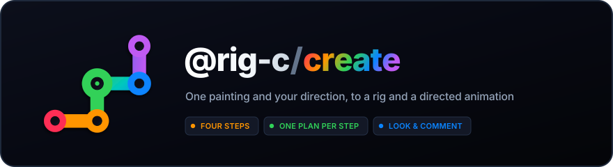

<p align="center">
  
</p>

<p align="center">
  <a href="https://www.npmjs.com/package/@rig-c/create"></a>
  <a href="https://www.npmjs.com/package/@rig-c/create"></a>
  <a href="LICENSE"></a>
</p>

# @rig-c/create

**A painting goes in. A rigged, directed animation comes out. An agent does the
work, and you judge it at four steps on a local review page.**

You do not rig anything yourself. The agent asks you questions before it works
and shows you each result. Nothing moves to the next step until you approve it.

create runs the whole cycle. The cutting, rigging and review page come from
[rig-c/parts](https://github.com/rig-c/parts),
[rig-c/core](https://github.com/rig-c/core) and
[rig-c/review](https://github.com/rig-c/review).

## The four steps

1. **Parts and meshes.** The agent asks what kind of rig this is and how the
   painting should be split, then cuts it into parts. You judge the parts and
   their meshes by eye.
2. **Rigging interview.** With the approved parts in front of you, the agent
   asks about bones, what deforms, physics and motions. You answer each
   question and sign the plan built from your answers.
3. **Rig and animation.** The agent builds the rig and its motions. You judge
   the rig alone on a fixed camera: seams, cuts, physics and the motions played
   in place.
4. **Direction.** The agent asks about camera, timing and what is around the
   figure, then composes the take. You judge the finished take and accept it.

Each question is multiple choice. It comes with the agent's recommendation and
its reason, an Other for your own words, and "auto". Auto is recorded as you
handing that decision to the agent. It is never left blank.

## Start

You need [Bun](https://bun.sh) 1.4.0 or newer and Git.

```sh
bunx rig-create init p1 --painting <your painting> --origin "<where it came from>"
bunx rig-create next p1
```

`init` wants a new or empty folder. It creates the project, copies the
painting into `inputs/`, installs the pinned rig-c packages and makes the first
Git commit. If the install fails the project is still there; run `bun install`
inside `p1`. `next` lists the moves that are open and whose they are.

To use the scoped name, run `bunx --package @rig-c/create rig-create …`. To
install globally, run `bun add -g @rig-c/create` and then `rig-create …`.

Now open `p1` with your agent. The folder holds its guide (`AGENTS.md`), and
the agent starts from there. Its first job is the review page:

```sh
rig-create job open p1 --reviewer <your id> --role owner
rig-create job acts p1 --wait
```

`job open` prints a private URL. Open it once and keep the page open. It
updates in place. `job acts --wait` is how the agent waits for you: it returns
when you submit something on the page and prints the command that records it,
or stops when its wait runs out.

## What the agent does, and what you do

The agent runs every command. It asks, drafts the plan, cuts, rigs, composes,
and publishes each result to your page. You look, answer, comment and approve
on that page.

Approval works the same way at every step. The agent keeps one `job open`
running in the background and shares its URL once. For each new ask it
publishes to the same page with `job open` and a selector (`--question`,
`--questions`, `--draft`, `--rig` or `--plan`). Then it runs `job acts --wait`,
and records what you submitted with the command that prints. Your words are
kept exactly as you gave them. If you ask for changes, the agent corrects the
work and shows you a new draft or version at the same step. Only your sign-off
moves a project forward. If you answer in chat, the agent can relay an
interview answer or a sign-off with your exact words, but a verdict on parts, a
rig or a take is given on the page. After an accepted take is sent back, the
agent records your correction with `amend direction-review`.

The full procedure, with recovery when the page stops, is in
[the live Review loop](docs/LIVE-REVIEW.md#the-live-review-loop).

## Commands

`rig-create --help` prints every command with its flags. One line each:

**The project**

- `init <dir>`: create a project folder, its Git repository and pinned packages.
- `input add <path> --origin <words>`: register a source file. A changed input needs a new file name.
- `owner-language set <tag>`: declare the language you are asked in.
- `next`: list the next moves and whose they are. It writes nothing.
- `interview --check`: name every hole the interview and plan still have. It exits nonzero until they are filled.
- `pause`, `resume <stage>`: stop work on your sign-off, and return to the stage it left.
- `restart`: start the record again at its first version, keeping the inputs and the fix ledger.
- `ledger add|retire <id>`: record or retire a fix of yours that every later version inherits.
- `packages upgrade`: update the project's pinned packages.

**The review page**

- `job open`: start the page, or publish a draft, rig, question or plan to it.
- `job acts`: list what you submitted and the command that records each. `--wait` waits for the next one.
- `job reconcile`: finish pending publications after a stopped page is opened again.
- `job withdraw-act <actId>`: take back a submitted act on your recorded words, keeping the page.
- `job close`: end the job.
- `republish <rig> --reason <words>`: publish a registered rig again without rebuilding it.

**Questions, plan and sign-offs**

- `interview-options <question>`: register the choices shown for one question.
- `interview-answer <question>`: record your pick.
- `interview-decision <question>`: record the agent's decision on a question you delegated.
- `plan add|revise|remove <id>`: draft plan steps, keeping what they replace.
- `signoff <stage>`: record your signature without moving the stage.
- `advance <stage>`: move to the next stage a sign-off allows.
- `step-status <step> <status>`: record a plan step's progress.
- `amend <stage>`: record a change to something already approved, and name the approvals that lapse.
- `checkpoint-evidence`: attach sealed evidence to the plan's checkpoints.
- `checkpoint-table`: lay out a producer report's rows as a table, without changing them.

**Parts and meshes**

- `intake-report`, `intake`: record a preflight report from parts and show its counts. It advises and never blocks approval.
- `derived add`: record preparation another tool already ran, with the files' hashes.
- `split-captions`: generate caption data for the split.
- `draft-rig <id>`: record a labelled draft without building or promoting it.
- `structure-snapshot --draft <id>`: prepare the structure snapshot before your verdict.
- `diff-classes`: read measured component classes, or record the agent's classification.
- `parts-review`: record your parts verdict. An approval also signs the step.
- `correction record|resolve`: record a correction you described or made, and how the agent resolved it.

**Rig and animation**

- `rig-version <n>`: register a frozen rig build.
- `review-package <n>`: copy the build's inputs for review and record the command that opens it.
- `review <version>`: record what you said about a shown version, word for word.
- `handoff`: name the accepted rig version that direction work runs on, or refuse.
- `version config-lost|outputs-lost <n>`: record what is missing from a version made before the interview.

**Direction**

- `direction write|check <N>`: author camera and timing as a document that never changes, and check it.
- `scene write`: record the background and foreground around the figure.

## Collections and scenes

Several rigs that belong together are a collection: shared answers are given
once, and each collection version pins exact member builds. Start one with
`init --collection <dir>` and `init --member <collection dir> <name>`, then use
`collection answer|pin|--check` and `collection-binding`
([docs/COLLECTIONS.md](docs/COLLECTIONS.md)).

A scene puts a background, and optionally a foreground, around an accepted rig
([scene composition](docs/PROJECT.md#scene-composition-and-direction2)).

## Docs

- [docs/PROJECT.md](docs/PROJECT.md): the project folder, data by lifetime,
  stages and sign-offs, the plan, versions.
- [docs/INTERVIEW.md](docs/INTERVIEW.md): the four user steps, answer states
  and shape, waypoints, post-production, provenance, polish feedback.
- [docs/LIVE-REVIEW.md](docs/LIVE-REVIEW.md): the review page loop, job
  commands, verdicts, sign-off routes and recovery.
- [docs/JOB-RETIREMENT.md](docs/JOB-RETIREMENT.md): closing a review job when
  the pinned packages change.
- [docs/CHECKS.md](docs/CHECKS.md): `rig-create interview --check`: every
  refusal code, what fires it, how to clear it.
- [docs/COLLECTIONS.md](docs/COLLECTIONS.md): several rigs that belong together:
  inherited answers, the reference member, composition, pins.
- [docs/AGENT-REFERENCE.md](docs/AGENT-REFERENCE.md): what an agent reads before
  it asks, plans or shows.
- [docs/CRAFT.md](docs/CRAFT.md): craft notes: the default proposed at each
  waypoint, and execution defects handed to rig-c/parts gates.
- [docs/SOURCE.md](docs/SOURCE.md): the layer split and the cut: what to do, in
  what order and why, read before `seethrough` and `assemble`.
- [docs/LESSONS.md](docs/LESSONS.md): the self-check every version passes
  before anyone looks, and the review lessons behind it.
- [docs/INVARIANTS.md](https://github.com/rig-c/create/blob/main/docs/INVARIANTS.md):
  how guide sentences translate into checks the rig must keep.
- [RELEASING.md](https://github.com/rig-c/create/blob/main/RELEASING.md):
  preparing and publishing a release.
- [templates/](templates/): the empty `project.json` and `collection.json`
  skeletons, and a worked example ([example-interview.md](templates/example-interview.md),
  [example-project.json](templates/example-project.json)) on a made-up painting.
  Its sign-offs are [synthetic fixture records](templates/example-draft/README.md).
  The remesh example records a request for a finer torso mesh as a forward
  amendment. [Remesh record](templates/example-remesh/project.json)

`init` creates projects from the empty templates; it does not copy the worked
examples. To check the installed examples against their recorded hashes, run
this from a project that has `@rig-c/create` installed. It names missing files
and hash mismatches, exits nonzero on either, and reads installed bytes only:

```sh
bun node_modules/@rig-c/create/scripts/verify-example-seals.ts
```

## The clock

Every command, writer and check takes the instant it runs at as an explicit
`now` (milliseconds since the epoch). That one value dates what a writer records
and bounds every "not in the future" refusal. The process entry in `src/cli.ts`
is the only place create reads the wall clock; it passes `Date.now()` to `main`.

Tests and generators never read or replace the global clock. Generators pass
their declared example instants. Tests call create through
[tests/clock.ts](https://github.com/rig-c/create/blob/main/tests/clock.ts), which passes the suite's instant, by default
twelve hours after the latest `*_SINCE` date; `testClock.set` moves it for the
next call. A test that needs a real process spawns
[tests/cli-at.ts](https://github.com/rig-c/create/blob/main/tests/cli-at.ts) with that instant. The only test that reads
the real clock is [tests/contract-dates.test.ts](https://github.com/rig-c/create/blob/main/tests/contract-dates.test.ts):
it fails, naming the constant, when a `*_SINCE` date is still in the future.

## Licence

[MIT](LICENSE).
