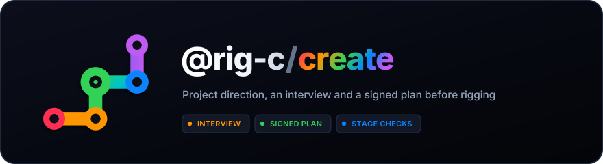

<p align="center">
  
</p>

<p align="center">
  <a href="https://www.npmjs.com/package/@rig-c/create"></a>
  <a href="https://www.npmjs.com/package/@rig-c/create"></a>
  <a href="LICENSE"></a>
</p>

# @rig-c/create

**Every rig starts as a project, and every project starts with the user's direction.**

This repository is where the rig-c project layer is built: the folder a rig is made
in, the interview that comes before any rigging, the plan the user signs, and the
guide an agent reads before it touches anything. It does not cut parts
([rig-c/parts](https://github.com/rig-c/parts) does) and it does not compile or
gate rigs ([rig-c/core](https://github.com/rig-c/core) does). It decides *what* and
*why*; those packages do *how*.

## Install and start

Requires [Bun](https://bun.sh) 1.4.0 or newer and Git. Run the published CLI
without a global install:

```sh
bunx rig-create --help
bunx rig-create init p1
bunx rig-create interview --check p1 --json
bunx rig-create next p1 --json
```

To pin the canonical scoped name, use `bunx --package @rig-c/create rig-create …`.

Or install it globally:

```sh
bun add -g @rig-c/create
rig-create --help
rig-create init p1
rig-create interview --check p1 --json
rig-create next p1 --json
```

Choose one route and a new or empty `p1` folder. `init` creates the project,
installs its pinned rig-c dependencies, and makes its first Git commit. If the
install fails, the project is still created; run `bun install` inside `p1` to
recover. Use `init p1 --no-install` only to defer dependency installation.
A fresh project's interview check reports the work still needed and exits
nonzero until its stage requirements are met. `next` reports the available
next actions; follow those through the review tool rather than editing records
by hand.

## Why it exists

An agent rigging a painting passes through the same places every time: the layer
split, the cut of each part, the bones, what deforms and what stays rigid, what
gets physics or wind, which motions it plays. Left alone at each of those places,
it guesses — and a guessed direction is only found out when a person watches the
result and sends it back. A precise direction, given before the work, is done in
one pass.

So the user gives direction at those places, in their own sentences, before the
work starts:

1. **Base motion** — the cut, the bones, what deforms, physics, the motions.
   Reviewed on a still frame, the rig alone.
2. **Direction** — camera, depth and timing, applied after the rig is accepted.
   Reviewed as a take. Camera keys and timing are authored with
   [`rig-create direction`](docs/PROJECT.md#authored-camera-direction-create92)
   in a hash-bound direction document; depth and turn remain in parts.
3. **Polish** — what the user says after seeing a result, kept word for word and
   tied to the place it is about.

Choosing "auto" at any place is allowed. It is recorded as the user handing that
decision to the agent, never left blank for the agent to fill.

## What it provides

- A project scaffold: one folder per rig, one record of its direction, sign-offs
  and versions, and data split by lifetime (inputs and evidence kept; derived data,
  outputs and scratch rebuilt or discarded).
- The interview, organised by the places the rig work always passes through.
- Translation of the user's sentences into checks the rig must keep, enforced by
  rig-c's `invariants` and named failures.
- Collections: several rigs that belong together, sharing direction and pinned to
  exact member builds.
- The guide an agent starts from, pointing at the installed packages' own
  documentation rather than copying it.

Release preparation and the owner-operated publication steps are in
[RELEASING.md](https://github.com/rig-c/create/blob/main/RELEASING.md).

## Recording approvals

Agents route human picks, corrections, verdicts and signatures through Review.
Open the relevant question, draft, rig/post version or plan, let the person act
in the tool, then use `job acts` and ingest its printed writer command:

```sh
rig-create job open <project dir> --reviewer <id> --role owner --plan
rig-create job acts <project dir>
rig-create signoff plan-approved --from-review <actId> <project dir>
rig-create parts-review <project dir> --from-review <actId>
rig-create structure-snapshot <project dir> --draft <id> --out evidence/structure-decisions.json
rig-create signoff parts-review --from-review <actId> --draft <id> --structure-file evidence/structure-decisions.json <project dir>
rig-create review <version> --from-review <actId> <project dir>
```

The commands illustrate separate acts; publish the matching subject before each
human act. Keep the Review host up across bound writes. If it stops, `job open`
again with reviewer/role, then `job reconcile` before more writes. `--rig <n>`
selects either a rig or a post version.

`signoff` records without moving the stage; `advance` uses its authority. Direct
`--by` sign-off/review and `interview-answer --pick` are low-level interfaces for
people operating the CLI themselves and synthetic fixtures, not an agent route
for human acts. Agents must not type an owner's answer or signature, or request
one in chat in place of Review. For a reopen, host `job open --plan`, let the
person choose the stage in Review, list the act with `job acts --json`, then ingest
`reopen <stage> --from-review <actId>` and `job close`. The exported act supplies
the reviewer, timestamp and unchanged words. See [the live Review flow](docs/LIVE-REVIEW.md)
and [the record contract](docs/PROJECT.md#recording-a-sign-off).

## The clock

Every command, writer and check takes the instant it runs at as an explicit
`now` (milliseconds since the epoch). That one value dates what a writer records
and bounds every "not in the future" refusal. The process entry in `src/cli.ts`
is the only place create reads the wall clock; it passes `Date.now()` to `main`.

Tests and generators never read or replace the global clock. Generators pass
their declared example instants. Tests call create through
[tests/clock.ts](https://github.com/rig-c/create/blob/main/tests/clock.ts), which passes the suite's instant, by default
twelve hours after the latest `*_SINCE` date; `testClock.set` moves it for the
next call. A test that needs a real process spawns
[tests/cli-at.ts](https://github.com/rig-c/create/blob/main/tests/cli-at.ts) with that instant. The only test that reads
the real clock is [tests/contract-dates.test.ts](https://github.com/rig-c/create/blob/main/tests/contract-dates.test.ts):
it fails, naming the constant, when a `*_SINCE` date is still in the future.

## Docs

- [docs/PROJECT.md](docs/PROJECT.md) — the project folder, data by lifetime,
  stages and sign-offs, the plan, versions.
- [docs/INTERVIEW.md](docs/INTERVIEW.md) — the three user steps, answer states
  and shape, waypoints, post-production, provenance, polish feedback.
- [docs/CHECKS.md](docs/CHECKS.md) — `rig-create interview --check`: every
  refusal code, what fires it, how to clear it.
- [docs/COLLECTIONS.md](docs/COLLECTIONS.md) — several rigs that belong together:
  inherited answers, the reference member, composition, pins.
- [docs/CRAFT.md](docs/CRAFT.md) — craft notes: the default proposed at each
  waypoint, and execution defects handed to rig-c/parts gates.
- [docs/SOURCE.md](docs/SOURCE.md) — the layer split and the cut: what to do, in
  what order and why, read before `seethrough` and `assemble`.
- [docs/LESSONS.md](docs/LESSONS.md) — the self-check every version passes
  before anyone looks, and the review lessons behind it.
- [templates/](templates/) — the empty `project.json` and `collection.json`
  skeletons, and a worked example ([example-interview.md](templates/example-interview.md),
  [example-project.json](templates/example-project.json)) on a made-up painting.
  Its sign-offs and the [reopened variant](templates/example-reopened/project.json)'s reopen
  are synthetic fixture records, not a person's approval
  ([why](templates/example-draft/README.md)).

## Verify the installed examples

From a consumer project with `@rig-c/create` installed, run:

```sh
bun node_modules/@rig-c/create/scripts/verify-example-seals.ts
```

The shipped, dependency-free script verifies every `files[]` entry and
`project_sha256` in the six example-chain checkpoint manifests (currently
319 checks). It names missing files and hash mismatches and exits nonzero.
It reads installed bytes only; it does not regenerate examples or run producers.
The CLI creates projects from empty templates; it does not copy worked examples.

See [release candidate verification](https://github.com/rig-c/create/blob/main/RELEASING.md#verify-the-release-candidate).

## Licence

[MIT](LICENSE).

New projects ask a separate multiple-choice question for each applicable ask,
with a reasoned agent recommendation, Other and explicit delegation. The shown
option file is retained by raw sha256. Record it with `interview-options`, then
open the question in Review and ingest its finalized act with `interview-answer --from-review <actId>`;
`interview-decision` records only the explicitly delegated asks. See
[the choice contract](docs/INTERVIEW.md#per-ask-choices-interview2) and the
[generated consumer fixture](templates/example-interview-choice.json).
Existing @1 projects keep their sentence history; adopt choices explicitly
with `interview-options --adopt`, without re-dating old answers.
